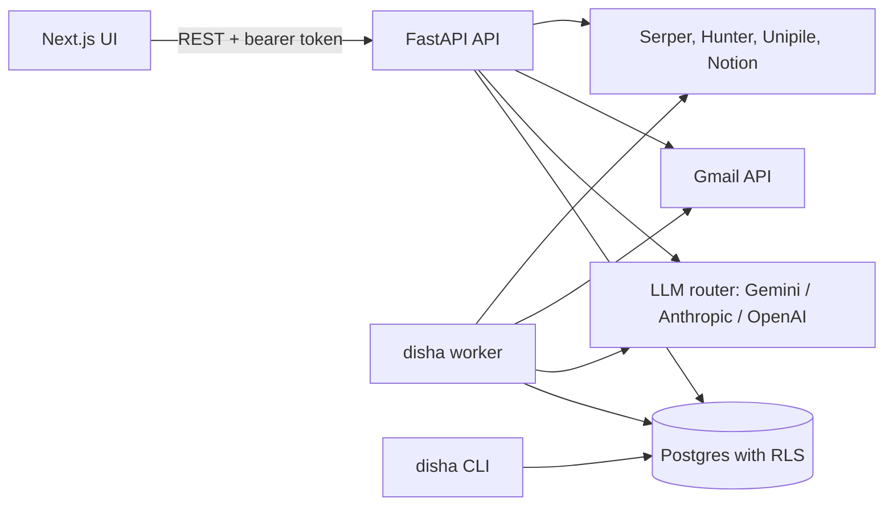

# Disha

Outbound automation for solo consultants. Disha finds and researches leads, scores them against your ideal-client profile, drafts personal emails in your voice, sends them from your own Gmail on a schedule, and sorts the replies so you can book calls.

## The problem

Independent consultants win most of their work through outbound, but doing it well takes hours a week: finding the right people, reading up on each company, writing a personal first email, following up on time, and catching replies. Most sequencing tools assume a sales team sending templates at volume. Disha automates the repetitive steps for one person and keeps them in control: a human approves every lead, and drafts too if they want.

## Features

The pipeline stages below are implemented. Stages that are only partly built are marked.

1. **Sourcing.** Turns the tenant's ICP rubric into search filters and pulls candidates from a provider. `mock` (the CLI and test default) returns deterministic demo leads on reserved `.example` domains, with no external calls. `web` runs several Serper.dev Google searches, has an LLM extract people and companies from the results, and finds emails with Hunter.io when a key is set. CSV import and single-lead add use the same dedup path. A saved search can run weekly. Apollo and Common Room providers are stubs.
2. **Enrichment.** For each lead, finds the company's real website via Serper, gathers snippets about the company and person, and asks the LLM for a company summary, why the lead fits you, why now, and an opening hook. A free email check rebuilds guessed addresses on the company's real domain.
3. **Scoring.** Each ICP rubric mixes rule-based dimensions (funding stage, team size, geography) and LLM-scored ones (role fit, pain signal). The weighted score maps to tiers A, B, C or skip. Scored leads wait for human approval before they enter a sequence. The ICP itself can be generated from interview answers or from a pasted resume or LinkedIn profile.
4. **Drafting.** Per-tenant, versioned prompt packs and a voice guide drive every draft, with separate first-touch prompts for India and US leads. If a draft runs over the word limit it is retried once, then flagged for review rather than cut. Drafts can be held for approval, edited, rejected or regenerated.
5. **Sending.** A cadence engine walks approved leads through multi-step sequences (email and LinkedIn steps). It respects send windows in the recipient's timezone, festival and year-end blocks, and a warm-up ramp (5 emails a day, growing 1.5x a week, capped at 30) or a flat daily cap. Email goes out through the Gmail API from the user's own mailbox as plain text plus HTML, with a signature built from settings rather than by the LLM. LinkedIn steps land in a manual queue; invites can also be sent through Unipile with a daily cap of 20.
6. **Qualification.** The worker polls Gmail threads for replies, detects bounces, and has the LLM classify intent. Meeting requests and interested replies move the lead to `replied` and email the user straight away. Out-of-office and "not now" pause the sequence. Unsubscribes stop the sequence and add the address to a suppression list.
7. **Booking (partial).** For each reply, a reply assistant drafts a response aimed at one call to action: the user's booking link. The user edits and sends it from the Inbox. There is no calendar integration, and nothing moves a lead to `booked` yet.
8. **Proposal (not built).** `proposal_sent` and `won` exist as lead states and in the funnel reports, but no code generates proposals.

Also included:

- Weekly optimizer: segments reply rates by country, funding stage and industry, asks the LLM for insights, reweights the next week's sourcing, and emails a digest.
- Reports for pipeline, daily and weekly activity, the funnel, and LLM cost with a monthly forecast.
- Optional Notion sync of leads to a Notion database.
- Admin console: cross-tenant overview, account creation, waitlist and invites, welcome emails.
- A CLI (`disha ...`) that covers nearly every API operation.

## Architecture



**Processes.** Three processes share one Postgres database: the API (`disha server`, FastAPI on Uvicorn), the background worker (`disha worker`), and the Next.js UI. There is no message broker. The worker is one asyncio process running interval loops: sequence tick (every 15 minutes by default), Gmail reply poll (every 5 minutes), LinkedIn auto-send (every 15 minutes), and weekly auto-sourcing and optimization (checked hourly, run once every 7 days). Each loop lists the active tenants on every pass, and one tenant's failure does not stop the others. Work state lives in Postgres: touch statuses (`draft`, `pending_approval`, `queued`, `sent`, ...) and a `manual_actions` table act as the queues.

**Multi-tenancy.** Every business table has a `tenant_id` and a Postgres row-level security policy that reads `app.tenant_id`. The app sets it per transaction with `set_config(..., true)`, so a session without tenant context sees zero rows. There are two database roles:

- `disha_admin` (`BYPASSRLS`) for schema setup, seeds, the worker, the CLI and auth lookups. Code on this role filters by `tenant_id` explicitly.
- `disha_app` (`NOBYPASSRLS`) for tenant-scoped API requests.

Per-tenant configuration (ICP rubric, prompt pack, voice guide, cadences, geo profile) is stored as versioned JSONB rows with one active version. New tenants are provisioned from a template (`ai_consulting` or `ux_design`). Lead emails are Fernet-encrypted, and a per-tenant salted SHA-256 hash is used for dedup.

**Auth.** Accounts are invite-only. Passwords are hashed with scrypt. Login returns a stateless HMAC-signed token (30-day expiry) that carries the user, tenant and admin flag. A master token (`DISHA_UI_TOKEN`) acts as admin on the `demo` tenant for bootstrap. The only rate limit is an in-memory per-IP limit on the public waitlist endpoint.

**LLM providers and BYOK.** All LLM calls go through `LLMRouter`. Callers ask for `fast`, `balanced` or `smart`, and the default table maps these to Gemini 2.5 Flash, Flash and Pro. Provider adapters exist for Gemini (native structured output), Anthropic (forced tool use) and OpenAI (`json_schema` response format). Transient errors are retried with tenacity; auth and schema errors are not. Every call is logged to `llm_calls` with tokens, cost and latency. Tenants can bring their own key per provider. Keys are validated on save and stored encrypted. The resolver uses the tenant's active key first. If the tenant only has revoked or expired keys it fails instead of silently billing the platform key. With no tenant key, it uses the platform key from the environment. Tests use a rules-based `MockProvider`, so the suite makes no network calls.

**Email.** Each tenant connects Gmail through an OAuth web flow from Settings (or `disha gmail auth` locally). Tokens are stored encrypted and refreshed automatically. Disha sends with `gmail.send` and reads replies with `gmail.readonly` by polling the threads it started.

## Tech stack

- Backend: Python 3.11, FastAPI, Uvicorn, SQLAlchemy 2 (async) with asyncpg, Alembic, Pydantic v2, Typer and Rich, cryptography (Fernet), tenacity
- LLM SDKs: google-genai, anthropic, openai
- Integrations: Gmail API (google-api-python-client), Serper.dev, Hunter.io, Unipile, Notion
- Database: PostgreSQL 16 with row-level security
- Frontend: Next.js 16 (App Router), React 19, Tailwind CSS 4, Radix UI, SWR, Recharts
- Tooling: uv, pytest with pytest-asyncio, ruff, mypy (strict)
- Deployment: Docker, Fly.io (API and worker), Vercel (UI), GitHub Actions

## Getting started

### Prerequisites

- Python 3.11+ and [uv](https://docs.astral.sh/uv/)
- Docker, for the local Postgres container
- Node.js 20 and npm, for the UI
- A Gemini API key, to run anything that calls an LLM outside the tests

### Setup

```bash
# 1. Install Python dependencies (creates .venv and uv.lock)
uv sync

# 2. Create your env file, then fill in DISHA_FERNET_KEY and DISHA_UI_TOKEN
cp .env.example .env
uv run python -c "from cryptography.fernet import Fernet; print(Fernet.generate_key().decode())"
uv run python -c "import secrets; print(secrets.token_urlsafe(48))"

# 3. Start Postgres (db/init/01-roles.sh creates the disha_admin and disha_app roles)
uv run disha db up

# 4. Create the schema on a fresh database: tables, RLS policies, grants, Alembic stamp
uv run python scripts/fly_init_db.py

# 5. Seed the demo tenant (slug "demo": ICP, prompts, voice guide, cadences)
uv run disha tenant seed

# 6. Check database, schema version, prompts and env vars
uv run disha health
```

Step 4 uses the init script because the Alembic chain does not replay on an empty database: `0001` builds tables from the current models, so later migrations collide with tables that already exist. On an initialised database, `uv run disha db migrate` applies any new migrations.

### Environment variables

`.env.example` lists every variable with a one-line comment. The main ones:

| Variable | Needed for | Where to get it |
| --- | --- | --- |
| `DATABASE_URL_ADMIN`, `DATABASE_URL_APP` | Everything | Your Postgres; the defaults match `docker-compose.yml` |
| `DISHA_FERNET_KEY` | Encrypting credentials and lead emails | Generate (command above) |
| `DISHA_UI_TOKEN` | Master token and signing key for user tokens | Generate (command above) |
| `GEMINI_API_KEY` | Platform LLM key (tenants can bring their own) | Google AI Studio |
| `ANTHROPIC_API_KEY`, `OPENAI_API_KEY` | Optional; not used by the default routing | Anthropic console, OpenAI platform |
| `GMAIL_CLIENT_ID`, `GMAIL_CLIENT_SECRET` | Sending and reply capture | Google Cloud Console: enable the Gmail API, create an OAuth client, add `{DISHA_API_URL}/api/v1/gmail/callback` as a redirect URI |
| `DISHA_API_URL`, `DISHA_UI_URL` | OAuth redirects, login links, notification emails | Your deployment URLs |
| `SERPER_API_KEY` | `web` sourcing and enrichment | serper.dev |
| `HUNTER_API_KEY` | Optional email finding | hunter.io |
| `UNIPILE_API_KEY`, `UNIPILE_DSN` | Optional LinkedIn automation | Unipile dashboard |
| `NOTION_TOKEN` | Optional, read by `disha notion auth` | Notion internal integration |

The UI reads one variable, `NEXT_PUBLIC_API_BASE` (see `ui/.env.example`).

### Run

```bash
# API on :8000 (OpenAPI docs at /docs)
uv run disha server --reload

# Background worker (sending, reply polling, weekly jobs)
uv run disha worker

# UI on :3000
cp ui/.env.example ui/.env.local
(cd ui && npm install && npm run dev)
```

`./dev.sh` starts the API and the UI together once `.env`, `ui/.env.local`, `.venv` and `ui/node_modules` exist.

To log in, create a user on the demo tenant with the master token:

```bash
curl -X POST http://localhost:8000/api/v1/admin/users \
  -H "Authorization: Bearer $DISHA_UI_TOKEN" -H "Content-Type: application/json" \
  -d '{"tenant_slug": "demo", "email": "you@example.com", "password": "choose-a-password", "is_admin": true}'
```

To try the pipeline without external accounts, use the `mock` sourcing provider from the Leads page (or `uv run disha sourcing preview`). Scoring and drafting still need an LLM key.

### Test

```bash
uv run pytest            # needs Postgres running and initialised (steps 3-4)
uv run ruff check .
uv run mypy
```

The tests run against the database in `DATABASE_URL_*` and truncate every table before each test, so point them at a separate database if you care about local data. LLM calls are mocked. `tests/test_live_gemini.py` is the one live test; it runs only when `DISHA_RUN_LIVE_LLM=1` and `GEMINI_API_KEY` are set in the shell.

## Deployment notes

The repo is set up for the API and worker on Fly.io and the UI on Vercel.

1. Replace `your-disha-app` in `fly.toml` with your Fly app name, and set `DISHA_API_URL` and `DISHA_UI_URL` there.
2. Create a Postgres database and the two roles (`db/init/01-roles.sh` has the SQL).
3. Set secrets:

   ```bash
   fly secrets set \
     DATABASE_URL_ADMIN=postgresql+asyncpg://disha_admin:<password>@<host>:5432/<db> \
     DATABASE_URL_APP=postgresql+asyncpg://disha_app:<password>@<host>:5432/<db> \
     DISHA_FERNET_KEY=<generated> DISHA_UI_TOKEN=<generated> \
     GEMINI_API_KEY=<key> GMAIL_CLIENT_ID=<id> GMAIL_CLIENT_SECRET=<secret> \
     DISHA_ALLOWED_ORIGINS=https://your-disha-ui.vercel.app
   ```

4. Make sure `uv.lock` exists (`uv lock`); `Dockerfile.prod` copies it.
5. `fly deploy`. The release command runs `scripts/fly_init_db.py`, which is idempotent. `fly.toml` defines two process groups, `app` (API) and `worker`.
6. Deploy `ui/` to Vercel with `NEXT_PUBLIC_API_BASE` set to the API URL.

`.github/workflows/deploy.yml` runs both deploys when triggered by hand and needs `FLY_API_TOKEN` and `VERCEL_TOKEN` repository secrets. `docker-compose.prod.yml` is an alternative single-host setup with Postgres, a one-off schema init, the API and the UI. It does not include the worker.

## Project structure

```
.
├── src/disha/
│   ├── api/              FastAPI app, auth, routes (/api/v1/...)
│   ├── adapters/         Gmail send + reply poller, Notion, Unipile
│   ├── db/               SQLAlchemy models, sessions, RLS helpers
│   ├── intelligence/     scorer, drafter, reply classifier, reply assistant, LinkedIn notes
│   ├── llm/              router, providers, BYOK key resolution, pricing, retry, mock
│   ├── sequencer/        cadence engine and send-window logic
│   ├── sourcing/         lead source interface, providers, ICP-to-query translation
│   ├── ingestion/        CSV import and dedup
│   ├── tenant/           provisioning, BYOK, settings, demo seed
│   ├── seeds/            demo tenant config and vertical templates (JSON)
│   ├── enrichment.py     company research and fit brief
│   ├── optimizer.py      weekly analysis and digest
│   ├── worker.py         background loops
│   └── cli.py            `disha` command
├── alembic/              migrations
├── scripts/fly_init_db.py  idempotent schema init (Fly release command)
├── db/init/              Postgres role setup for the local container
├── tests/                pytest suite and fixtures
├── ui/                   Next.js frontend
├── docker-compose.yml    local Postgres
├── docker-compose.prod.yml
├── Dockerfile.prod
└── fly.toml
```

## Status and limitations

Disha is a working product built by one person. It is not a finished public SaaS: there is no self-serve signup or billing, and accounts are created by an admin.

- Booking and proposals are not automated (see Features). A discovery-call briefing prompt exists in the prompt packs but no code calls it.
- The default LLM routing uses Gemini only. The Anthropic and OpenAI adapters are used only if you change `DEFAULT_MODEL_MAP` in `src/disha/llm/router.py`.
- The Alembic history does not build a fresh database; use `scripts/fly_init_db.py` for that.
- The worker is meant to run as a single process. There is no distributed queue or locking. Authenticated API routes have no rate limiting.
- Email sending is Gmail only, and replies are found by polling.
- The defaults lean toward India and the US: cadences, send windows and the festival calendar are written for those two markets.
- LinkedIn auto-send goes through Unipile, which drives the user's own LinkedIn account. It stays off until Unipile is configured, the tenant connects an account, and the `linkedin_auto` setting is on. Check LinkedIn's terms before you use it.
- LLM prices in `src/disha/llm/pricing.py` are a hand-maintained table.
- The test suite needs a real Postgres database and wipes it.
